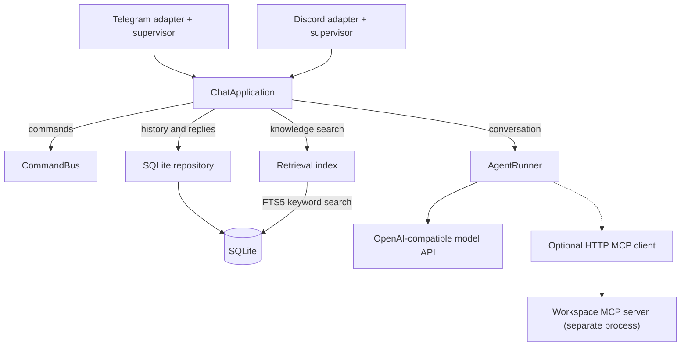

# yachiyo 2 Architecture

## Project structure

```text
yachiyo/
├── config/                   Operator and build configuration
│   ├── config.toml           Active local settings
│   ├── config.example.toml   Template for a new installation
│   ├── .secrets/             Local credential files
│   ├── yachiyo.container     Rootless Podman user service
│   ├── Containerfile         Core and workspace image targets
│   └── ruff.toml             Python lint and formatting rules
├── src/yachiyo/
│   ├── __main__.py           CLI entry point
│   ├── bootstrap.py          Assembles the core process
│   ├── config/               Loads and validates settings
│   ├── domain/               Identities, messages, sessions and permissions
│   ├── application/          Chat, commands, agent, memory and policies
│   ├── ports/                Interfaces used by the application
│   ├── adapters/             Telegram, Discord, model, storage, retrieval and MCP
│   ├── integrations/         Media generation and reverse-image search
│   ├── runtime/              Transport supervision, background jobs and health
│   ├── sql/                  Database schema and migrations
│   └── workspace/            Standalone workspace MCP server
├── docs/                     Architecture and deployment
└── .github/workflows/        CI and image publishing
```

## Process topology

The CLI loads the configuration, then `bootstrap.py` starts the enabled transports
and connects them to one chat application. Each transport has its own supervisor
that delivers replies back to the originating platform.



No transport starts or owns another transport. Each supervisor has its own retry loop,
health state and client lifecycle. The application receives only normalized domain
events and returns a platform-neutral response plan.

## Dependency rule

`domain` contains immutable Python types and imports only the standard library.
`application` imports only configuration, domain types and ports. `adapters` implement
ports using external SDKs. `runtime` supervises adapters. `bootstrap.py` is the only
composition root. New modules must preserve this dependency direction.

The editable runtime configuration lives in `config/`. The Python package
`src/yachiyo/config/` resolves paths, loads TOML and validates its contents.
Within persistence, `sql/schema.py` applies the SQL files in `sql/migrations/`,
and `adapters/storage/outbox.py` persists and cleans up files attached to pending
replies. The SQLite repository owns the transaction that records each reply.

## Request flow

1. A transport maps an update to `InboundEvent` with provider-qualified identity,
   conversation address, attachments and verified platform permissions.
2. SQLite atomically claims the external event ID to provide restart-safe idempotency.
3. Group policy computes a `SessionKey`; transport, bot, chat and scope always
   participate, while topic and owner dimensions are included only for their matching
   session modes.
4. Rate limits and a bounded per-session lock run before expensive work.
5. `ChatApplication` loads trusted server-side history, profile data and scoped
   public/private retrieval results.
6. `AgentRunner` executes a bounded OpenAI-compatible tool loop. It has no mutable
   conversation field and receives all state per request.
7. The user/assistant turn, response outbox, usage and optional memory job are committed
   in one SQLite transaction before transport delivery.
8. The originating transport renders text limits, buttons and media for its platform.

The durable outbox provides at-least-once delivery. Telegram and Discord do not expose
a transaction spanning multi-part sends, so a process or network failure after a
platform accepts only part of a response can duplicate that accepted prefix on replay.
Model and remote read-only tool calls are likewise at-least-once across process crashes;
non-read-only MCP calls require a separately persisted user approval.

## Data model

SQLite stores provider-qualified identities, chats, conversations, messages, roles,
profiles, group policy, memories, documents, chunks, event receipts, durable jobs,
tool approvals and usage. Foreign keys, WAL and a busy timeout are enabled at startup.
Numbered SQL files are the only migration mechanism.

Document chunks and memories have separate SQLite FTS5 indexes. Ingestion and search
use the same tokenizer for Latin and Chinese text. Each query searches the caller's
scope and the public scope. The index can be rebuilt locally from the stored text
in a single transaction. Older v2 databases may retain unused vector tables.

## Trust boundaries

- System instructions contain only application-authored text. Profiles, group context,
  retrieval and tool output enter the model as explicitly untrusted user/tool data.
- Unmentioned group observation and group learning are disabled by default. Enabling
  group memory records consent in SQLite.
- Secrets are references in TOML and values in `/run/secrets` or explicit development
  environment variables. Effective configuration and logs never contain secret values.
- MCP accepts only configured HTTP endpoints, does not spawn commands, prefixes every
  tool name, requires an explicit non-empty allowlist, limits response bytes, filters
  access and requires persistent approval for every non-read-only tool.
- Media and reverse-image integrations validate HTTPS hosts, resolved public IPs,
  redirects, MIME types, magic bytes, response sizes and timeouts.
- The workspace MCP server is a separate container. It rejects traversal, `.git` file
  access and symlinks; arbitrary shell is unavailable and checks come from a fixed list.

## Lifecycle

Startup validates configuration, opens and migrates SQLite, seeds
roles, initializes integrations and then starts worker, heartbeat and all transports in
one task group. A transport exception is contained inside its supervisor. Shutdown
stops intake, closes transports, finishes active worker tasks, closes HTTP clients and
then closes SQLite. `health.json` is atomically refreshed for OCI health checks.

## Optional components

The standard core does not require the official MCP SDK because its client is a bounded
aiohttp implementation. The `mcp`/`workspace` extras exist only for building custom MCP
servers.
